# Boot Sequence

**Generated:** 2026-06-08 | **Phase:** 1

This document traces every stage from Cortex-M reset to the first published `sensor_msgs::Imu` message. Every claim is anchored to source file:line.

## Stage map

| Stage | File:line | What runs | Wall-clock |
|---|---|---|---|
| 0. Reset | `startup_stm32f401retx.s:60-101` | Cortex-M reset vector → `Reset_Handler` | t=0 |
| 1. `SystemInit` | `system_stm32f4xx.c` (vendor) | Enable FPU CP10/CP11; set vector table location | <1 ms |
| 2. Data + BSS init | `startup_stm32f401retx.s:67-95` | Copy `.data` from FLASH to RAM; zero `.bss` | <1 ms |
| 3. C runtime init | `startup_stm32f401retx.s:97-100` | `__libc_init_array` (static C++ constructors — none in this firmware) | <1 ms |
| 4. `main` entry | `main.c:103` | HAL infrastructure init | t≈1 ms |
| 5. `HAL_Init` | `main.c:113` | `HAL_MspInit`; **TIM1 timebase** via `HAL_InitTick`; flash latency | t≈2 ms |
| 6. `SystemClock_Config` | `main.c:120, 170-210` | HSI → PLL → 84 MHz; APB1 /2, APB2 /1; voltage scale 2 | t≈3 ms |
| 7. `MX_GPIO_Init` | `main.c:127`, `gpio.c:37-76` | GPIOA + GPIOB clocks; PA5 LED reset; **PB4 EXTI4 falling, pull-up, priority 5,0** | t≈3 ms |
| 8. `MX_DMA_Init` | `main.c:128`, `dma.c:39-57` | DMA1 + DMA2 clocks; NVIC priorities 5,0 for Streams 5, 2, 7 | t≈3 ms |
| 9. `MX_I2C1_Init` | `main.c:129`, `i2c.c:30-57` | I²C1 at 400 kHz, PB8/PB9 alt-fn open-drain | t≈3 ms |
| 10. `MX_TIM2_Init` | `main.c:130`, `tim.c:30-86` | TIM2 prescaler 84−1, period 20000−1, PWM1 mode, PA0/PA1 alt-fn | t≈3 ms |
| 11. `MX_USART1_UART_Init` | `main.c:131`, `usart.c:35-61` | USART1 9600 baud (the dead USART1 init dead) + DMA2 RX/TX + NVIC priority 5 | t≈4 ms |
| 12. `MX_USART2_UART_Init` | `main.c:132`, `usart.c:64-90` | USART2 460 800 baud + DMA1 RX (unused, the unused USART2 RX DMA) + NVIC priority 5 | t≈4 ms |
| 13. IWDG SKIPPED | `main.c:135-140` | the IWDG-disabled state: `IWDG_Init_Direct()` call commented out | t≈4 ms |
| 14. `osKernelInitialize` | `main.c:145` | CMSIS-RTOS V2 wrapper init | t≈4 ms |
| 15. `MX_FREERTOS_Init` | `main.c:148`, `freertos.c:82-91` | Creates `microROSTask` with stack=12000 bytes, priority Normal | t≈4 ms |
| 16. `osKernelStart` | `main.c:151` | Scheduler starts; `microROSTask` enters Ready, then Running | t≈4 ms |
| 17. `StartDefaultTask` | `freertos.c:98` | BNO085 init → micro-ROS bring-up → calibration → infinite loop | t≈4-6500 ms |
| 18. First IMU publish | `freertos.c:341-400` | First `data_valid` after calibration completes | t≈6500-7000 ms |

## Detailed trace

### Stage 0 — Reset

Reset releases the CPU at the address pointed to by the vector at FLASH+0x4 — which is `Reset_Handler`. The initial stack pointer is `_estack = ORIGIN(RAM) + LENGTH(RAM) = 0x20018000` (`STM32F401RETX_FLASH.ld:39, 47`).

The reset condition can be: power-on, BOR, NRST pin, software (`NVIC_SystemReset`), IWDG, WWDG, or low-power. The team's fault handlers + `Error_Handler` all path through `NVIC_SystemReset` (except `Error_Handler` which hangs — the Error_Handler hang behaviour) or NMI (which hangs deliberately).

### Stage 1 — `SystemInit`

CMSIS-defined. Three actions:
1. Enable FPU access via `SCB->CPACR |= ((3UL << 10*2) | (3UL << 11*2))` (CP10 + CP11 full access).
2. Set vector table location: `SCB->VTOR = FLASH_BASE | VECT_TAB_OFFSET`.
3. Configure HSE bypass / HSI default (HSI 16 MHz on).

Note: FPU access is granted at hardware level. This is **required** for the C compiler's `-mfloat-abi=hard` output to function. But FreeRTOS port save/restore is governed separately by `configENABLE_FPU` .

### Stage 2 — Data + BSS init

```asm
/* Copy the data segment initializers from flash to SRAM */
  ldr r0, =_sdata
  ldr r1, =_edata
  ldr r2, =_sidata
  ...

/* Zero fill the bss segment. */
  ldr r2, =_sbss
  ldr r4, =_ebss
  ...
```
(`startup_stm32f401retx.s:67-95`)

`_sidata`, `_sdata`, `_edata` are linker symbols defined in `STM32F401RETX_FLASH.ld:134-149`. The `.data` section is loaded at `_sidata` (in FLASH) and runtime-located at `_sdata..._edata` (in RAM). The startup copies it.

`_sbss..._ebss` are zeroed. This includes:
- The standard FreeRTOS heap (`ucHeap` in vendor `heap_4.c`) — 32 KB.
- The custom micro-ROS heap (`ucHeap` in `custom_memory_manager.c:30`) — 32 KB.
- The UART ring (`it_buffer` in `it_transport.c:31`) — 2 KB.
- All `static` and global zero-initialised data.

After this stage, ~64 KB of RAM is committed to heaps that aren't yet allocated from. the dual-heap sizing.

### Stage 3 — C runtime init

`__libc_init_array` runs each function pointer in `.init_array` (linker section). For this firmware, the array is empty — no C++ static constructors. Negligible time.

### Stages 4-12 — Peripheral init

`main` (lines 103-164):

```c
HAL_Init();
SystemClock_Config();
MX_GPIO_Init();
MX_DMA_Init();
MX_I2C1_Init();
MX_TIM2_Init();
MX_USART1_UART_Init();
MX_USART2_UART_Init();
```

Each is a CubeMX-generated initializer. On failure they call `Error_Handler` (the Error_Handler hang behaviour risk).

**Key clock-tree fact (`main.c:170-210`):**
- Oscillator: HSI (16 MHz internal RC)
- PLL: PLLM=8, PLLN=84, PLLP=/2 → 84 MHz SystemClock
- AHB = 84 MHz
- APB1 = 42 MHz (PCLK1), timer clock = 84 MHz (because APB1 prescaler != 1, timer clock is doubled per F4 ref manual)
- APB2 = 84 MHz (PCLK2)
- Voltage scale 2 (allows up to 84 MHz)
- FLASH latency 2 wait states

Per-peripheral notes:
- **GPIO** (`gpio.c:37-76`): PA5 = output PP, low speed, no pull. PB4 = input, EXTI falling-edge, **pull-up**, priority 5 (matches `configMAX_SYSCALL_INTERRUPT_PRIORITY`). SYSCFG clock enabled for EXTI line mapping.
- **DMA** (`dma.c:39-57`): three streams configured (DMA1_Stream5 for USART2 RX, DMA2_Stream2 for USART1 RX, DMA2_Stream7 for USART1 TX), all at priority 5,0. None used at runtime (the dead USART1 init, the unused USART2 RX DMA).
- **I²C1** (`i2c.c:30-57`): 400 kHz Fast-mode, 7-bit addressing, no clock stretch, no general call, duty cycle 2 (16/9 high/low ratio for 400 kHz).
- **TIM2** (`tim.c:30-86`): Internal clock source, PWM1 mode, prescaler 84−1, period 20000−1, OC polarity high, both channels (PA0/PA1) configured with pulse 0 initially. PWM is **not started** here — `HAL_TIM_PWM_Start` is called from `freertos.c:209-210`.
- **USART2** (`usart.c:64-90`): 460800 baud, 8N1, no flow control, oversampling 16. The DMA RX init is left over from earlier design .

### Stage 13 — IWDG NOT started 

```c
/* IWDG INTENTIONALLY DISABLED at boot.
 * Re-arm by uncommenting the line below ONLY after on-bench verification
 * of (a) PA5 2 Hz heartbeat and (b) XRCE-DDS session establishment.
 *
 * IWDG_Init_Direct();
 */
```
(`main.c:135-140`)

`IWDG_Refresh_Direct()` is called periodically from `freertos.c` (NOT PROVEN — grep needed; likely never called given comment context). Since IWDG isn't started, the refresh writes are harmless no-ops.

### Stages 14-16 — FreeRTOS kernel start

- `osKernelInitialize()` — sets up the CMSIS-RTOS V2 wrapper.
- `MX_FREERTOS_Init()` — calls `osThreadNew(StartDefaultTask, NULL, &microROSTask_attributes)`. Stack = 3000 × 4 = 12 KiB. Priority = Normal.
- `osKernelStart()` — never returns. The scheduler takes over. `microROSTask` enters Running.

### Stage 17 — `StartDefaultTask` (the long bring-up)

This is the meat. From `freertos.c:98-266`:

```mermaid
sequenceDiagram
    participant K as FreeRTOS Kernel
    participant T as microROSTask
    participant B as BNO085 (I²C)
    participant A as XRCE-DDS Agent (Jetson)
    participant TIM as TIM2 PWM

    K->>T: schedule (priority Normal)
    T->>B: BNO085_Init (osDelay 100, flush 5 packets)
    T->>B: BNO085_EnableReport(ROTATION_VECTOR, 10ms) → osDelay 10
    T->>B: BNO085_EnableReport(ACCELEROMETER, 10ms) → osDelay 10
    T->>B: BNO085_EnableReport(GYROSCOPE, 10ms) → osDelay 10
    T->>T: rmw_uros_set_custom_transport(huart2, it_transport.c callbacks)
    T->>T: Install custom rcl_allocator → rcutils_set_default_allocator
    loop until agent answers
        T->>A: rmw_uros_ping_agent(100, 1)
        Note over T,A: osDelay(100) on fail
    end
    T->>A: rmw_uros_sync_session(1000)
    T->>T: rcl_init_options + set_domain_id(42)
    T->>T: rclc_support_init_with_options
    T->>T: rclc_node_init_default("odyssix_imu_node")
    T->>T: rclc_publisher_init_default(/microros/imu_raw)
    T->>T: rclc_executor_init(1)
    T->>T: rclc_subscription_init_default(/control/command)
    T->>T: rclc_executor_add_subscription
    T->>TIM: HAL_TIM_PWM_Start(CH1) + HAL_TIM_PWM_Start(CH2)
    T->>TIM: CCR1 = 1500 (steering neutral)
    T->>TIM: CCR2 = 1500 (ESC neutral) — **deadman default before any command**
    T->>T: sensor_msgs__msg__Imu__init
    T->>T: assign frame_id "imu_link"; set covariances
    T->>T: BNO085_PerformStartupCalibration (2 s blocking)
    Note over T,B: ~200 samples averaged at 100 Hz<br/>baseline quaternion pre-conjugated<br/>Z-accel offset forced zero
    T->>K: enter for(;;) loop
```

**Critical ordering decisions:**

1. BNO085 init **before** XRCE-DDS ping — so the BNO085 settling time overlaps with the ping wait.
2. Custom allocator install **before** any rcl entity creation — so all rcl heap goes to the right pool.
3. PWM **started before calibration** with explicit 1500 µs latch — so the vehicle is physically still during the 2 s calibration window.
4. Calibration **after** session sync — so the first published frame has wall-clock-disciplined timestamps.
5. Publisher created **before** calibration starts — so the calibration's eventual first-tick publish has somewhere to go.

### Stage 18 — Main loop entry

Once calibration completes (~6.5-7 s after reset), the task enters its 1 kHz cooperative loop. See `data_flow_graph.md` for the per-tick walk-through.

## Mermaid: Boot sequence diagram

```mermaid
flowchart TB
    R[Reset] --> RH[Reset_Handler<br/>startup.s]
    RH --> SI[SystemInit<br/>CMSIS]
    SI --> DI[Data init<br/>copy .data]
    DI --> BI[BSS zero]
    BI --> LI[__libc_init_array]
    LI --> M[main]
    M --> HI[HAL_Init]
    HI --> CC[SystemClock_Config<br/>84 MHz]
    CC --> GP[MX_GPIO_Init]
    GP --> DM[MX_DMA_Init]
    DM --> I2[MX_I2C1_Init]
    I2 --> T2[MX_TIM2_Init]
    T2 --> U1[MX_USART1_UART_Init<br/>9600 dead]
    U1 --> U2[MX_USART2_UART_Init<br/>460800]
    U2 --> IW[IWDG SKIPPED]
    IW --> OK[osKernelInitialize]
    OK --> FI[MX_FREERTOS_Init]
    FI --> KS[osKernelStart]
    KS --> SD[StartDefaultTask]
    SD --> BN[BNO085_Init + 3 EnableReports]
    BN --> XT[XRCE-DDS transport]
    XT --> AL[Custom allocator]
    AL --> PA[Wait for agent ping]
    PA --> SY[Session sync]
    SY --> ENT[micro-ROS entities]
    ENT --> PW[TIM2 PWM start + 1500 µs neutral]
    PW --> IM[IMU msg init]
    IM --> CAL[2 s calibration]
    CAL --> LP["for(;;) main loop"]
    style IW fill:#ff8888
    style PW fill:#88ff88
```



Red: known safety gap . Green: critical safety latch (deadman default before any command arrives).

## Failure-mode review of boot

| Stage | Failure | Behaviour | Mitigation |
|---|---|---|---|
| 1-3 | Hardware fault | None (running on bare metal) | Reset NRST |
| 4-12 | Peripheral init fails | `Error_Handler` → hang  | Operator reset; **needs fix** |
| 17 BNO085 init | I²C bus stuck | `BNO085_Init` proceeds anyway (returns OK regardless); subsequent reads fail | 50-error auto-recovery |
| 17 agent ping | Agent not running | Loops in `rmw_uros_ping_agent` with 100 ms delay forever | Operator brings up docker; firmware unfreezes |
| 17 calibration | Sensor silent for 2 s | Returns HAL_ERROR; caller (`freertos.c:266`) discards | **F-2 silent failure path; raised in audit** |
| 18 publish | OOM in custom heap | rcl_publish returns error; firmware continues | None automatic |

## What we did NOT investigate this pass

- Linker map output (would show exact `.data` and `.bss` sizes).
- `system_stm32f4xx.c` walk-through (vendor; just need to know it enables FPU + sets vectors).
- HSI calibration register write (HSI has a runtime calibration value).
- Bootloader entry condition (boot pins).

These are all NOT PROVEN; if needed for the operator manual, they can be added in a follow-up pass.
