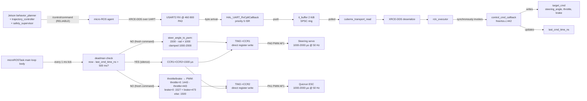

# Data Flow Graph

**Generated:** 2026-06-08 | **Phase:** 1

End-to-end data flow from sensors through firmware to actuators and ROS topics.

## Inbound — BNO085 IMU → published `sensor_msgs::Imu`

```mermaid
flowchart LR
    SENS[BNO085 internal fusion<br/>9-DoF accel + gyro + mag<br/>onboard EKF]
    SENS -- "SHTP cargo via I²C @ 100 Hz" --> BUS["I²C1 bus 400 kHz<br/>PB8 SCL / PB9 SDA"]
    SENS -- "INTN active-LOW<br/>open-drain" --> INTN[PB4]

    INTN --> EXTI4[EXTI4_IRQHandler<br/>priority 5]
    EXTI4 -- "set flag" --> FLAG["volatile bool<br/>bno085_int_flag"]

    BUS --> I2C_RX[HAL_I2C_Master_Receive<br/>polled, 100 ms timeout]
    FLAG -. "polled in loop" .-> TASK[microROSTask main loop]
    I2C_RX -.-> TASK

    TASK -- "ReadPacket: 4-byte header" --> RX_BUF[rx_buf 128 bytes]
    RX_BUF -- "ReadPacket: length-driven cargo" --> RX_BUF
    RX_BUF --> PARSER[BNO085_ParseInputReport<br/>multi-report walker]

    PARSER -- "0x01 Accelerometer" --> ACC[lin_accel_x/y/z<br/>Q8 m/s²]
    PARSER -- "0x02 Gyroscope" --> GYR[gyro_x/y/z<br/>Q9 rad/s]
    PARSER -- "0x05 Rotation Vector" --> QUAT[quat_i/j/k/real<br/>Q14 + accuracy Q12]
    PARSER -- "0xFA/0xFB Timebase" --> NOP[skip]
    PARSER -- "any_parsed → data_valid=true" --> VALID[data_valid flag]

    QUAT -- "|q|² ∈ [0.9, 1.1] gate" --> QUAT
    QUAT -- "(if EMI corruption: keep last good)" --> QUAT

    VALID -- "consumed by publish gate" --> PUBL[Publish path]

    ACC -- "subtract offset_accel_x/y" --> PUBL
    ACC -- "Z preserved (gravity for EKF)" --> PUBL
    GYR -- "subtract offset_gyro_x/y/z" --> PUBL
    QUAT -- "Hamilton baseline_inv * q_raw + normalise" --> PUBL

    PUBL -- "sensor_msgs::Imu w/ frame_id 'imu_link', covariances" --> RCL[rcl_publish]
    RCL --> XRCE[XRCE-DDS serialize]
    XRCE --> TXW[cubemx_transport_write]
    TXW -- "blocking HAL_UART_Transmit" --> U2[USART2 @ 460 800<br/>PA2 TX]
    U2 -- "UART to docker" --> AGENT[micro-ROS agent<br/>(on Jetson)]
    AGENT -- "RMW publish on CycloneDDS" --> JETSON_EKF[Jetson ekf_localization_node]
```

## Outbound — Jetson `/control/command` → PWM CCR



## Per-tick walk of main loop (`freertos.c:271-437`)

Every 1 ms (~1 kHz cadence enforced by `osDelay(1)`):

```mermaid
flowchart TB
    START[loop iteration N]
    START --> SP[rclc_executor_spin_some<br/>timeout=0 → non-blocking]
    SP -- "callback fired?" --> CB{control_cmd_callback<br/>invoked synchronously}
    CB -- "Yes" --> WCMD[Update target_cmd<br/>+ last_cmd_time_ns]
    CB -- "No" --> NEXT
    WCMD --> NEXT[sync_tick++]
    NEXT --> SYNC{sync_tick >= 1000?<br/>(~10 s)}
    SYNC -- "Yes" --> DOSY[rmw_uros_sync_session(10)]
    SYNC -- "No" --> TIME
    DOSY --> TIME[time_ns = rmw_uros_epoch_nanos]
    TIME --> GATE{INT gate:<br/>flag set<br/>OR PB4 LOW?}
    GATE -- "Yes" --> CLEAR[clear flag]
    GATE -- "No" --> VAL
    CLEAR --> READ[BNO085_GetData<br/>(2-stage I²C read + parse)]
    READ -- "OK" --> ERR_RESET[err_count=0]
    READ -- "FAIL" --> ERR_INC[err_count++]
    ERR_INC --> ERR50{err_count >= 50?}
    ERR_50 -- "Yes" --> RECOV[BNO085_Init +<br/>3 EnableReport calls<br/>(calib NOT re-run)]
    ERR_50 -- "No" --> VAL
    RECOV --> VAL
    ERR_RESET --> VAL
    VAL{data_valid?}
    VAL -- "Yes" --> BUILD[build IMU msg:<br/>Hamilton baseline_inv × q_raw<br/>+ normalise<br/>+ subtract offsets]
    BUILD --> PUB[rcl_publish<br/>blocking TX ~1.9 ms]
    PUB --> CLEAR_V[data_valid=false]
    VAL -- "No" --> LED
    CLEAR_V --> LED
    LED[led_tick++]
    LED --> LED50{led_tick >= 50?}
    LED_50 -- "Yes" --> TOG[Toggle PA5]
    LED_50 -- "No" --> ACT
    TOG --> ACT[Deadman + PWM]
    ACT --> DLY[osDelay(1)]
    DLY --> END[next iteration]
```

## Data structures

| Struct | Where | Size | Lifetime | Hot path? |
|---|---|---|---|---|
| `BNO085_Handle_t` (`bno085.h:74-83`) | `static bno085` in `freertos.c:40` | ~400 bytes (rx_buf 132 + tx_buf 128 + seq[6] + data 52 + calib 48 + flags) | Process lifetime | Touched every BNO085 read |
| `bno085.data` (`BNO085_Data_t`) | inside handle | ~52 bytes (11 floats + bool) | Process lifetime | Hot |
| `bno085.calib` (`BNO085_Calibration_t`) | inside handle | ~48 bytes (10 floats + bool) | Set once at boot calibration | Read on every publish |
| `target_cmd` (`bfmc_msgs__msg__ControlCommand`) | `static target_cmd` in `freertos.c:41` | ~12 bytes (3 floats) | Process lifetime | Read every loop iteration |
| `imu_msg` (`sensor_msgs__msg__Imu`) | `static imu_msg` in `StartDefaultTask` | ~280 bytes (header + 4 quaternions + 3 vec3 + 3×9 covariances) | Process lifetime (post-init) | Written every publish |
| `it_buffer[2048]` | static in `it_transport.c:31` | 2 KiB | Process lifetime | Hot (every RX byte) |
| `it_head`/`it_tail` | static `volatile uint32_t` | 8 bytes | Process lifetime | Hot |
| `last_cmd_time_ns` | `static volatile int64_t` in `freertos.c:42` | 8 bytes | Process lifetime | Read+write every loop |

## Wire formats

### `/microros/imu_raw` (`sensor_msgs::Imu`)

Per ROS message definition:
- `header` (std_msgs::Header): seq, stamp (sec + nanosec), frame_id (string)
- `orientation` (geometry_msgs::Quaternion): 4 × float64
- `orientation_covariance` (float64[9])
- `angular_velocity` (geometry_msgs::Vector3): 3 × float64
- `angular_velocity_covariance` (float64[9])
- `linear_acceleration` (geometry_msgs::Vector3)
- `linear_acceleration_covariance` (float64[9])

XRCE-DDS-encoded size with `frame_id = "imu_link"`: ~280 bytes including alignment. Plus XRCE framing: ~10-20 bytes. Net wire size ~300 bytes per publish.

At 100 Hz: 30 KB/s. At 460 800 baud: ~52 % link utilisation. Sustainable.

### `/control/command` (`bfmc_msgs::ControlCommand`)

NOT PROVEN exact size; expected ~20-40 bytes. At 20 Hz: <1 KB/s. Trivial.

## Failure-mode traces (data-flow view)

### A — BNO085 silent

- Bus quiet → ReadPacket returns HAL_ERROR.
- `BNO085_GetData` returns HAL_ERROR → err_count++.
- After 50 ticks (~500 ms), auto-recovery re-inits + re-enables reports.
- If still silent: data_valid stays false → no publish → Jetson EKF sees stale.

### B — UART TX fails

- `HAL_UART_Transmit` returns HAL_ERROR.
- `cubemx_transport_write` returns 0.
- XRCE serialization fails silently.
- Subsequent attempts try again.

### C — XRCE-DDS agent disconnect

- `rmw_uros_ping_agent` (called in init only) doesn't help post-init.
- Publisher continues to publish; the XRCE library buffers undelivered messages.
- Buffer eventually exhausts (custom heap OOM) — see memory_graph Scenario A.

### D — `/control/command` stops

- Last `last_cmd_time_ns` ages.
- After 500 ms, deadman triggers; CCR1=CCR2=1500.
- Vehicle parks.

### E — I²C bus stuck (NACK forever)

- HAL_I2C_Master_Receive returns timeout (100 ms) → HAL_ERROR.
- Auto-recovery re-calls `BNO085_Init`, which calls `HAL_I2C_Master_Receive` for flush — also fails.
- Loop continues indefinitely (no firmware reset path).
- IWDG would recover  if enabled.

## Throughput summary

| Channel | Rate | Effective bandwidth |
|---|---|---|
| I²C1 read (header + cargo) | ~100 Hz × ~30 bytes = ~3 KB/s | at 400 kHz, the actual on-wire time is ~5 ms × 100 = 500 ms/s = 50 % bus utilisation |
| `/microros/imu_raw` publish | ~100 Hz × ~300 bytes = 30 KB/s | ~52 % of 460 800 baud link |
| `/control/command` receive | ~20 Hz × ~30 bytes = 0.6 KB/s | <1 % link |
| Total UART link load | ~30.6 KB/s | ~53 % of 460 800 baud usable bandwidth |

Headroom on the link: ~45 % for XRCE session control + retransmits + clock sync.

## What this firmware does NOT plumb

- Multiple sensors (BNO085 is the only one).
- Multiple actuators (servo + ESC on TIM2 only).
- Diagnostic / debug topics from firmware (no `/microros/diagnostics`).
- Configuration topics (no runtime tuning from Jetson; everything pinned in firmware).
- Bidirectional flow control (no acknowledgement of control commands back to Jetson).
