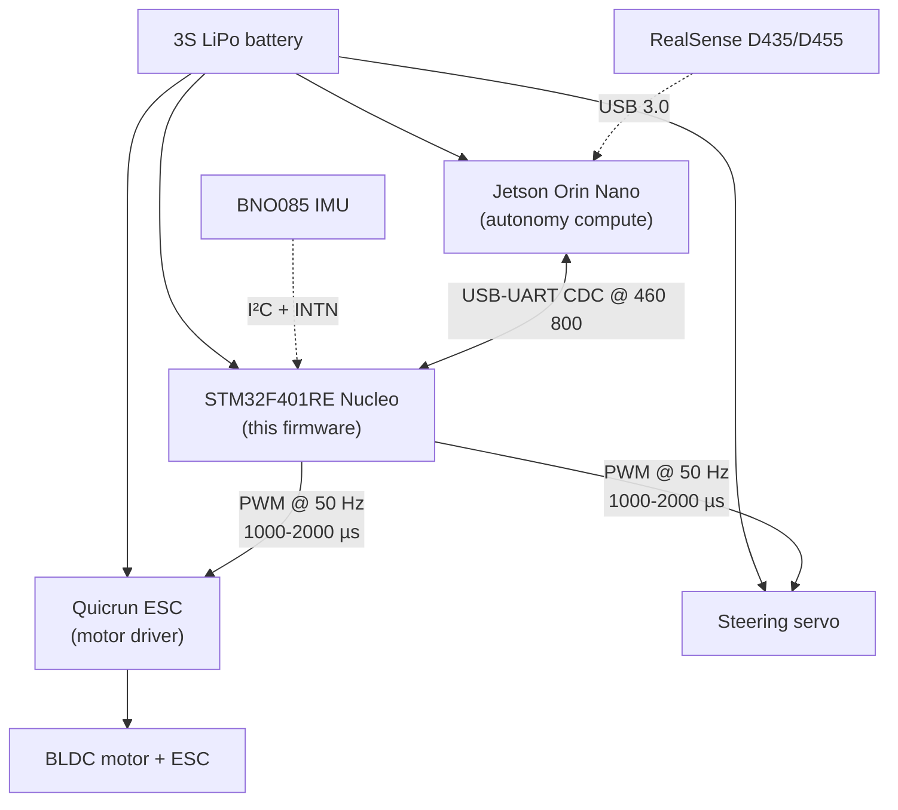

# Deployment Architecture

**Generated:** 2026-06-08 | **Phase:** 1

This document covers how the firmware fits into the larger BFMC vehicle and what is required for deployment.

## Vehicle-level placement



## Software stack

```mermaid
flowchart TB
    APP["BFMC autonomy<br/>(behavior, planning, control)"]
    APP --> ROS2["ROS 2 Humble<br/>+ CycloneDDS"]
    ROS2 --> AGT["micro-ROS agent<br/>(in docker container)"]
    AGT -- "XRCE-DDS over CDC UART" --> CDC["USB CDC link"]
    CDC -- "USB-UART" --> STM_USART["USART2 @ 460 800<br/>(Nucleo USB-CDC bridge)"]
    STM_USART --> RCL["rcl + rclc + rmw_microxrcedds<br/>(static lib)"]
    RCL --> ALC["custom_memory_manager.c<br/>(32 KB heap)"]
    RCL --> IT["it_transport.c<br/>(2 KiB SPSC ring + IT RX + blocking TX)"]
    APP_FW["Application firmware<br/>(microROSTask in freertos.c)"] --> RCL
    APP_FW --> BNO["bno085.c<br/>(SHTP driver)"]
    APP_FW --> TIM["TIM2 PWM<br/>(servo + ESC)"]

    BNO --> HAL_I2C[STM HAL I²C]
    TIM --> HAL_TIM[STM HAL TIM]
    HAL_I2C --> CMSIS[CMSIS]
    HAL_TIM --> CMSIS
    APP_FW --> FRTOS[FreeRTOS 10.3.1<br/>+ heap_4 (vendor, 32 KB)]
    FRTOS --> CMSIS
    CMSIS --> HW[STM32F401RE hardware]
```

## Physical connectivity

| Connection | Wire | Notes |
|---|---|---|
| Jetson ↔ STM32 | USB cable to Nucleo's USB connector | The Nucleo's ST-LINK chip provides USB-CDC bridge to USART2. ST-LINK can also flash. |
| STM32 ↔ BNO085 | 4 wires: VCC, GND, SCL (PB8), SDA (PB9) + 1 wire INTN (PB4) | I²C pull-ups: NOT PROVEN whether external pull-ups are needed (BNO085 modules often have them on-board). Internal pull-up on PB4 is enabled by GPIO config. |
| STM32 ↔ Servo | 3 wires: GND, +5V (NOT from STM32 — typically from BEC), PWM signal from PA0 | Servo expects 5V; STM32 PWM at 3.3V; needs a level shifter or open-collector buffer (assumed external to Nucleo). |
| STM32 ↔ ESC | 3 wires: GND, signal from PA1 (PWM), receiver/BEC | ESC has internal BEC; servo can take power from ESC's BEC line. |

See `hardware/system_connections.md` for the canonical wiring diagram.

## micro-ROS agent topology

The micro-ROS agent runs in a docker container on the Jetson host. Communication path:

```
STM32 USART2 (PA2 TX / PA3 RX)
   │ via Nucleo ST-LINK USB-UART bridge
   ▼
Jetson USB port → /dev/ttyACM* (Linux)
   │
   ▼
Docker container with --device=/dev/ttyACM*
   │
   ▼
micro_ros_agent serial --dev /dev/ttyACM* --baudrate 460800
   │
   ▼
RMW Cyclone DDS publishes /microros/imu_raw on the Jetson host
```

The docker container's `docker-compose.yml` (in the workspace repo) declares the device pass-through.

## Boot ordering (whole-system)

| Stage | Time | What |
|---|---|---|
| 1. Power on | t=0 | Battery applied. STM32 + Jetson + ESC + servo all power up. |
| 2. STM32 boots | t≈0-7 s | Per `boot_sequence.md`. PWM goes to 1500 µs neutral immediately after TIM2 start (~stage 17). ESC sees neutral and arms. Servo holds centered. **Critical: PWM must be neutral before ESC arms, or ESC may interpret as throttle.** |
| 3. ESC arm beep | t≈2-5 s | ESC sequences through its arm beeps; expects neutral PWM throughout. |
| 4. Jetson boots Linux | t≈0-45 s | Slower than STM32 (full Linux). |
| 5. Docker daemon up | t≈45-60 s | Required before micro-ROS agent. |
| 6. micro_ros_agent container starts | t≈60-65 s | Connects to ttyACM*. |
| 7. STM32 `rmw_uros_ping_agent` succeeds | t≈65 s | STM32 firmware finally proceeds past ping loop. |
| 8. Session sync | t≈65 s | Clock-aligned. |
| 9. Calibration (2 s) | t≈65-67 s | Vehicle must be still. |
| 10. First IMU publish | t≈67 s | Jetson EKF starts receiving. |
| 11. Autonomy launch starts | depends on operator | `ros2 launch race_day.launch.py` |
| 12. `vehicle_ready` true | autonomy + ~25 s | system_state_machine ladder. |
| 13. Run start | operator-triggered | Vehicle is autonomous. |

**Critical:** between t≈0 (power on) and t≈10 (Jetson + docker up), the STM32 firmware is looping in `rmw_uros_ping_agent`. During this entire window:

- PWM IS at neutral (no command received yet — `last_cmd_time_ns == 0` → deadman engaged).
- BNO085 IS running (its INTN is firing, but the data is sampled and stored in `bno085.data` — not published yet).
- BUT: the firmware has not yet called `BNO085_PerformStartupCalibration`. Calibration happens AFTER session sync (stage 9).

This means: **if the vehicle is moved before stage 9**, the calibration's "baseline quaternion" captures a non-rest orientation. The team's protocol is "don't move the vehicle until the LED blinks at 10 Hz" — which is the post-boot heartbeat indicating calibration completed.

## ROS topic contract

| Topic | Producer | Consumer | QoS (default) | Frame rate |
|---|---|---|---|---|
| `/microros/imu_raw` | STM32 (`microROSTask`) | Jetson `imu_driver` → `/imu/data_filtered` → EKF | RELIABLE pub × BE sub (by Jetson choice; see workspace audit B-1) | ~100 Hz |
| `/control/command` | Jetson `safety_supervisor` | STM32 (`control_cmd_callback`) | RELIABLE both sides | Jetson controller rate ~20 Hz |

ROS domain ID 42. **Hardcoded** in firmware (`freertos.c:173`) AND set via env in race-day launch (`race_day.launch.py:440`). Mismatch = silent no-discovery.

## Reproducibility checklist (for a new BFMC team)

| Item | Required | Notes |
|---|---|---|
| STM32F401RE Nucleo board (NUCLEO-F401RE) | Yes | The same board, not a variant (board-pin-mapping is encoded in the .ioc). |
| BNO085 module (e.g., Adafruit BNO085 breakout, or CEVA BNO085 + adapter PCB) | Yes | I²C addr 0x4A (ADR LOW). |
| Quicrun ESC (specific model) | Specific | Bench test for brake==1.0 → reverse mapping (`safety_supervisor` defaults to max_brake=0.5). |
| Steering servo (any standard 50 Hz PWM 1000-2000 µs) | Generic | |
| Jetson Orin Nano (or compatible) | Yes for autonomy | The firmware itself works with any ROS 2 Humble host. |
| micro-ROS agent container (matching XRCE-DDS protocol version) | Yes | Version mismatch = silent no-session. |
| arm-none-eabi-gcc toolchain | Yes | Tested with arm-none-eabi-gcc 10+. |
| micro_ros_stm32cubemx_utils static library | Yes | Built once per micro-ROS version; `libmicroros.a` checked into a known location (per `Makefile:130`). |
| 3S LiPo battery (or equivalent) | For vehicle | STM32 can be powered from USB during dev. |

## Operator-facing build/flash flow

```bash
# Initial setup
git clone <repo>
cd bfmc-embedded-backup

# Build (requires arm-none-eabi-gcc on PATH)
make

# Flash via ST-LINK
# (Many options; typical: st-flash write build/odyssix_stm32_core.bin 0x08000000)
# Or use STM32CubeProgrammer GUI.

# Verify
# Connect Jetson docker side first, then power on STM32.
# Check /dev/ttyACM* device on Jetson; start agent.
# Expect /microros/imu_raw at ~100 Hz within 10 s of agent start.
```

## Hardware revision tolerance

If the team's mechanics swap:

- **BNO085 → BNO080 (predecessor):** SHTP protocol is similar; some report formats differ. NOT a drop-in.
- **F401RE → F411RE:** mostly compatible (same pinout); FPU is the same. Should build with the same Makefile.
- **Different ESC:** the PWM mapping (`steer_angle_to_pwm` / throttle/brake conversion) is calibrated for Quicrun. A different ESC needs bench-test characterization (`freertos.c:421-431` numeric constants).
- **Different servo:** PWM range is generic 1000-2000 µs; should work.

## Deployment-grade gaps (open items for release)

| Gap | Action item |
|---|---|
| No documented USB-CDC driver/port detection script for Jetson | Add to operator manual |
| Hardcoded ROS domain ID (42) in firmware | Add a build-time `-DROS_DOMAIN_ID=42` flag in Makefile + use it in `freertos.c` |
| No firmware version string published on boot | Add `RCL_*` log line or a one-shot diagnostic publish |
| IWDG disabled | documented in `docs/design_decisions/15_iwdg_disabled.md` |
| No bootloader option | Acceptable for competition vehicle |

## Resilience properties summary

| Property | Status | Source |
|---|---|---|
| Boot-time PWM neutral | YES | `freertos.c:213-214` |
| Deadman on `/control/command` silence | YES (500 ms) | `freertos.c:411-434` |
| Fault → reset → boot-time PWM neutral re-applied | YES | `stm32f4xx_it.c` all fault handlers |
| `Error_Handler` → reset | NO (hangs with interrupts disabled) | `main.c:241-249` |
| IWDG hangs recovery | NO (IWDG disabled at boot) | `main.c:135-140` |
| BNO085 auto-recovery on 50 errors | YES (re-init; calib preserved) | `freertos.c:315-326` |
| UART overrun self-heal | YES (ErrorCallback re-arms) | `it_transport.c:123-138` |
| Stack overflow → handler | NOT PROVEN | `FreeRTOSConfig.h` lacks `configCHECK_FOR_STACK_OVERFLOW` |
| Heap OOM → handler | NOT PROVEN (`vApplicationMallocFailedHook`) | `FreeRTOSConfig.h` lacks `configUSE_MALLOC_FAILED_HOOK` |
