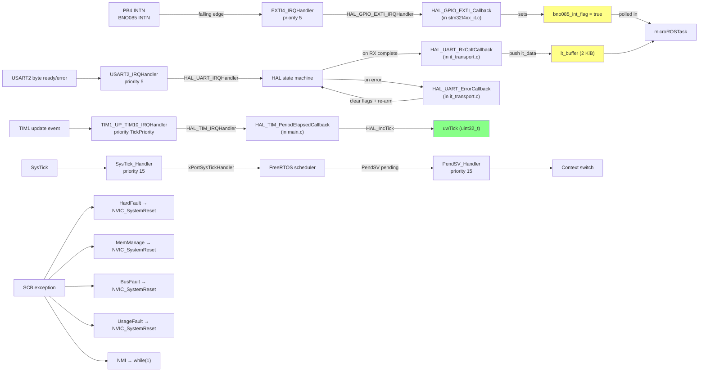

# Interrupt Graph & Forensics

**Generated:** 2026-06-08 | **Phases:** 1 + 2

This document inventories every ISR active in the firmware, documents shared resources, priority assignments, latency profile, and race risks.

## Active ISRs

| ISR | Vector | Source | NVIC priority | Trigger | Body | LOC | File:line |
|---|---|---|---|---|---|---|---|
| `EXTI4_IRQHandler` | EXTI line 4 | PB4 BNO085 INTN falling | **5, 0** | INTN goes LOW | Sets `bno085_int_flag = true` | 1 line | `stm32f4xx_it.c:266-271` |
| `USART2_IRQHandler` | USART2 global | RXNE / TC / errors | **5, 0** | byte ready / TX done / error | Calls `HAL_UART_IRQHandler(&huart2)` → dispatches to `HAL_UART_RxCpltCallback` or `HAL_UART_ErrorCallback` | 1 dispatch | `stm32f4xx_it.c:224-233` |
| `USART1_IRQHandler` | USART1 global | (dead client) | 5, 0 | n/a (huart1 has no consumer) | Calls `HAL_UART_IRQHandler(&huart1)` | 1 dispatch | `stm32f4xx_it.c:210-219` |
| `DMA1_Stream5_IRQHandler` | DMA1 ch4 USART2 RX | (configured, unused — the unused USART2 RX DMA) | 5, 0 | TC/HT/error | Calls `HAL_DMA_IRQHandler(&hdma_usart2_rx)` | 1 dispatch | `stm32f4xx_it.c:182-191` |
| `DMA2_Stream2_IRQHandler` | DMA2 ch4 USART1 RX | (dead — the dead USART1 init) | 5, 0 | TC/HT/error | Calls `HAL_DMA_IRQHandler(&hdma_usart1_rx)` | 1 dispatch | `stm32f4xx_it.c:238-247` |
| `DMA2_Stream7_IRQHandler` | DMA2 ch4 USART1 TX | (dead — the dead USART1 init) | 5, 0 | TC/HT/error | Calls `HAL_DMA_IRQHandler(&hdma_usart1_tx)` | 1 dispatch | `stm32f4xx_it.c:252-261` |
| `TIM1_UP_TIM10_IRQHandler` | TIM1 update | HAL 1 ms tick | **TickPriority** (set by `HAL_InitTick`, NOT PROVEN exact value — typically 0 or 15) | TIM1 update event | Calls `HAL_TIM_IRQHandler(&htim1)` → `HAL_TIM_PeriodElapsedCallback` → `HAL_IncTick` | 1 dispatch | `stm32f4xx_it.c:196-205` |
| `SysTick_Handler` | SysTick | FreeRTOS scheduler | `configKERNEL_INTERRUPT_PRIORITY` = 15 (lowest) | 1 ms FreeRTOS tick | `xPortSysTickHandler` — task switching | (port code) | (FreeRTOS port) |
| `PendSV_Handler` | PendSV | FreeRTOS context switch | **15, 0** (lowest) | Set pending by scheduler | `xPortPendSVHandler` | (port code) | `stm32f4xx_hal_msp.c:75` sets priority |
| `SVC_Handler` | SVC | FreeRTOS port | (default 0; usable from EXC_RETURN) | `svc` instruction (kernel start, syscall) | `vPortSVCHandler` | (port code) | mapped via FreeRTOSConfig.h:159 |

## Exception (fault) handlers

| Handler | File:line | Action |
|---|---|---|
| `NMI_Handler` | `stm32f4xx_it.c:83-93` | **infinite loop** (deliberate — clock fault unrecoverable) |
| `HardFault_Handler` | `stm32f4xx_it.c:98-112` | `NVIC_SystemReset()` |
| `MemManage_Handler` | `stm32f4xx_it.c:117-127` | `NVIC_SystemReset()` |
| `BusFault_Handler` | `stm32f4xx_it.c:132-142` | `NVIC_SystemReset()` |
| `UsageFault_Handler` | `stm32f4xx_it.c:147-157` | `NVIC_SystemReset()` |
| `DebugMon_Handler` | `stm32f4xx_it.c:162-170` | empty (debugger only) |

## NVIC priority model

| Concept | Value | Source |
|---|---|---|
| Priority bits | 4 | `configPRIO_BITS = 4` (`FreeRTOSConfig.h:131`) |
| `configMAX_SYSCALL_INTERRUPT_PRIORITY` | 5 | `FreeRTOSConfig.h:142` |
| `configKERNEL_INTERRUPT_PRIORITY` | 15 (lowest) | `FreeRTOSConfig.h:136, 146` |
| PendSV | 15 | `stm32f4xx_hal_msp.c:75` |
| All peripheral ISRs | 5 | `gpio.c:73`, `dma.c:48-55`, `usart.c:154, 200` |
| HAL TIM1 timebase | passed via `HAL_InitTick(uwTickPrio)` | `stm32f4xx_hal_timebase_tim.c:92`; NOT PROVEN: what `uwTickPrio` resolves to at init time. Default in HAL is typically `TICK_INT_PRIORITY = 0` (highest). |

**Important implication:** because peripheral ISRs are at priority 5 (== `configMAX_SYSCALL_INTERRUPT_PRIORITY`), they are *exactly at* the floor — meaning they MAY call FreeRTOS `*FromISR` APIs. ISRs at priority < 5 (numerically lower) would NOT be allowed to call FreeRTOS APIs.

The TIM1 timebase priority is the one variable not visible at this audit pass. If TIM1 fires at priority 0 (the HAL default), it preempts every other ISR — but its body is trivial (`HAL_IncTick`). No risk.

## Interrupt dependency graph



Yellow: shared variables between ISR and task. Green: HAL-internal state (read-only from app perspective).

## Shared variables (ISR ↔ task)

| Variable | Type | Writers | Readers | Synchronisation | Race risk |
|---|---|---|---|---|---|
| `bno085_int_flag` | `volatile bool` | `HAL_GPIO_EXTI_Callback` (ISR) | task (`freertos.c:308`, `bno085.c:373`) | none — single-bit volatile, ARMv7-M atomic | **Safe.** Race is documented and intentional: clearing before read + pin-LOW fallback. |
| `it_data` | `static uint8_t` | HAL UART internal (target of `HAL_UART_Receive_IT(&it_data, 1)`); read by `HAL_UART_RxCpltCallback` | none — pushed into ring | Same ISR context (HAL state machine + callback); no cross-context race | Safe. |
| `it_buffer[2048]` | `static uint8_t` | RX ISR (write) | task `cubemx_transport_read` (read) | SPSC ring (`it_head` consumer-writes, `it_tail` producer-writes) | **Safe** by SPSC pattern. |
| `it_head` | `volatile uint32_t` | task | task + ISR (read) | volatile + word-atomic | Safe. |
| `it_tail` | `volatile uint32_t` | RX ISR | task (read) + ISR | volatile + word-atomic | Safe. |
| `last_cmd_time_ns` | `volatile int64_t` | task (`control_cmd_callback` writes, main loop reads) | task (both sites) | callback runs in `rclc_executor_spin_some` — same task context | Safe today. **Risk:** 64-bit volatile is non-atomic on ARMv7-M; if a future maintainer moves the callback to a different task, torn read possible. Document. |
| `target_cmd` (`bfmc_msgs__msg__ControlCommand`) | static | task (callback + main loop read) | task | same context | Safe. |
| `uwTick` (HAL) | `volatile uint32_t` | `TIM1_UP_TIM10` callback chain | `HAL_GetTick` from any context | Atomic 32-bit write; reader gets one value or another | Safe. |
| `bno085.data` | `BNO085_Data_t` (~50 bytes float struct) | task (parser) | task (publish) | same context | Safe. |

## Potential hazards by ISR

### EXTI4

- Body sets a single bool. Trivially safe.
- **Priority 5** matches `configMAX_SYSCALL_INTERRUPT_PRIORITY` — could call `xQueueSendFromISR` in future, but currently doesn't.
- **No blocking HAL call** in the ISR (I²C read is in task context).
- **Latency:** ISR entry < 100 ns; body < 200 ns total.

### USART2 RX

- HAL handler runs at priority 5. Inside it:
  - HAL state machine reads SR + DR (to clear flags).
  - Dispatches to `HAL_UART_RxCpltCallback` (`it_transport.c:109-117`) which pushes one byte + re-arms.
- **Hazard:** HAL UART driver internally takes `__HAL_LOCK`. The TX path also takes this lock. If a TX is in progress on the same UART when the RX ISR fires — they share state. The team's blocking TX (`HAL_UART_Transmit`) is synchronous, so this can't happen on USART2 (TX blocks the task; the ISR can fire during the TX but only for RX byte, which HAL handles independently).
- **Latency:** ISR + HAL state machine + callback < 5 µs typically.

### USART2 Error

- `HAL_UART_ErrorCallback` clears all four error flags (`ORE/NE/FE/PE`), drains DR, aborts RX, re-arms RX. The fix that turned single-overrun-wedges-receiver into self-healing.
- **Latency:** worst case ~10 µs.

### TIM1 timebase

- Trivial body: `HAL_IncTick` increments `uwTick`.
- **Latency:** <500 ns.

### SysTick + PendSV

- FreeRTOS port code (`port.c` in `ARM_CM4F`). At priority 15 (lowest).
- PendSV does the context switch. Has special FPU handling (with `configENABLE_FPU=0`, no FPU save/restore — the FPU context-save state). Safe with single task.

## Race conditions

### Race 1 — BNO085 back-to-back packets

**Scenario:** packet N becomes ready; INTN drops LOW; EXTI4 fires; flag set. Task reads packet N (5 ms I²C). Mid-read, packet N+1 becomes ready; INTN was already LOW so no new falling edge; flag stays clear; task finishes packet N, sees flag clear, doesn't read.

**Mitigation:** `freertos.c:308-309` and `bno085.c:373-374` combine flag-OR-pin-LOW:

```c
if (bno085_int_flag || HAL_GPIO_ReadPin(GPIOB, GPIO_PIN_4) == GPIO_PIN_RESET) {
    bno085_int_flag = false;   /* clear BEFORE read */
    BNO085_GetData(&bno085);
}
```

Race-free. Pattern documented in source.

### Race 2 — UART RX ISR vs `cubemx_transport_read`

**Scenario:** task reads ring; concurrently ISR writes to ring.

**Mitigation:** SPSC ring. `it_head` is consumer-owned (writer = task); `it_tail` is producer-owned (writer = ISR). Each is volatile word-sized. No need for locks.

### Race 3 — USART2 IRQ vs `HAL_UART_Transmit`

**Scenario:** task is calling `HAL_UART_Transmit` (blocking). Mid-call, RX byte arrives, USART2 IRQ fires.

**Mitigation:** HAL UART state machine handles TX and RX via separate state variables; the ISR only affects RX state, not TX state. The blocking TX is a polling loop on the TX EMPTY flag — independent of RX.

### Race 4 — control_cmd_callback vs main loop reads target_cmd

**Scenario:** main loop reads `target_cmd.throttle`; mid-read, callback fires and updates `target_cmd`.

**Mitigation:** the callback is called **synchronously** from `rclc_executor_spin_some` (`freertos.c:278`), which is called from the main loop body — same task context. Cannot interleave. Safe.

### Race 5 — `last_cmd_time_ns` 64-bit volatile

**Scenario:** task reads `last_cmd_time_ns` (8 bytes); concurrently callback writes it.

**Mitigation today:** same task context (see Race 4). No cross-context race possible.

**Future risk:** if a maintainer moves `control_cmd_callback` to its own task, the 64-bit non-atomic read could tear (read low word, callback writes both halves, read high word) producing a corrupt 64-bit value. The deadman would then misbehave for one tick.

## Latency budget

Assuming nothing else preempts:

| Event | Worst-case latency to handler entry |
|---|---|
| EXTI4 falling edge → `EXTI4_IRQHandler` first instruction | ~12 cycles (Cortex-M4 IRQ entry) at 84 MHz = ~143 ns |
| USART2 byte arrival → `USART2_IRQHandler` first instruction | ~143 ns |
| TIM1 update → `TIM1_UP_TIM10_IRQHandler` | ~143 ns |
| Any fault → fault handler → `NVIC_SystemReset` → reset start | ~30 cycles + reset wall-clock |

Assuming priority-5 ISRs cannot preempt each other (they are all at the same priority — first-come-first-served within priority level), worst-case ISR-to-ISR latency is the duration of the in-progress ISR (~10 µs worst-case for USART2 Error path).

## Recommended changes (NOT MADE — findings only)

1. **Document the TIM1 timebase priority value** explicitly. If it's 0 (the HAL default), it preempts every peripheral ISR. NOT PROVEN this is intentional.
2. **Add a comment to `last_cmd_time_ns`** explaining the single-task assumption and torn-read risk if maintainer-modified.
3. **Consider lowering DMA1_Stream5 to disabled** since it's unused . Reduces ISR vector population and one less thing to think about.

## Interview notes

- "Why are all the peripheral ISRs at priority 5?" — because `configMAX_SYSCALL_INTERRUPT_PRIORITY = 5` in FreeRTOSConfig.h, and we want every ISR to be able to call FreeRTOS APIs if needed.
- "Why is PendSV at priority 15?" — FreeRTOS port requirement. PendSV does the actual context switch and must run **after** any pending higher-priority ISR completes. Setting it to the lowest priority guarantees this.
- "Why is the EXTI4 handler so short?" — separation of concerns: the ISR latches the event; the I²C read happens in task context where it can block on HAL timeout without holding the CPU at high priority.
- "What's the race-free read pattern?" — flag-OR-pin-LOW combined check, with the flag cleared before the read so any mid-read re-assert produces a fresh latch for the next tick.
