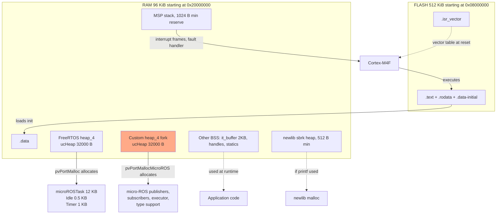

# Memory Graph

**Generated:** 2026-06-08 | **Phase:** 1 + 6 + 8

## RAM layout — 96 KiB total

```
0x20018000  ┌─ _estack (top of RAM, MSP starting value)
            │
            │   MSP stack reservation (1 KiB, _Min_Stack_Size = 0x400)
            │
0x20017C00  ├─ stack limit (max heap growth point per sbrk)
            │
            │   newlib sbrk heap (small; 512 B reserve from _Min_Heap_Size = 0x200)
            │   PROVIDE(end = .) PROVIDE(_end = .)
            │
            │   .bss (zero-initialised statics)
            │     ├─ ucHeap[32000]    — FreeRTOS internal heap (vendor heap_4.c)
            │     ├─ ucHeap[32000]    — micro-ROS heap (custom_memory_manager.c:30) ← the dual-heap sizing
            │     ├─ it_buffer[2048]  — UART RX ring (it_transport.c:31)
            │     ├─ bno085 (handle struct, ~400 bytes)
            │     ├─ target_cmd (ControlCommand, ~16 bytes)
            │     ├─ huart1/2, hi2c1, htim1/2, hdma_* (handle structs)
            │     ├─ FreeRTOS internal: xStart/pxEnd linked-list sentinels (per heap)
            │     ├─ ulStackEndAddress and related
            │     └─ everything else `static`
            │
            │   .data (initialised statics, copied from FLASH at boot)
            │     └─ small — most globals are zero-init (.bss)
            │
0x20000000  └─ RAM origin
```

## RAM budget table

| Region | Size | Notes |
|---|---|---|
| `.data` | NOT PROVEN (~few hundred bytes) | Initialised globals |
| `.bss` of which: | (sum below) | Zero-initialised |
| └ FreeRTOS heap_4 `ucHeap` | 32 000 bytes | Vendor heap |
| └ custom micro-ROS heap `ucHeap` | 32 000 bytes | the dual-heap sizing |
| └ UART RX ring `it_buffer` | 2 048 bytes | SPSC |
| └ BNO085 + HAL handles + ROS structs | NOT PROVEN (~2-3 KiB) | |
| Newlib sbrk heap | 512 bytes min reserve | `_Min_Heap_Size` in linker |
| MSP stack reserve | 1 024 bytes | `_Min_Stack_Size` in linker |
| **Subtotal known** | **~67.5 KiB** | |
| Tasks (allocated from FreeRTOS heap): | (sum below) | |
| └ microROSTask stack | 12 000 bytes | `osThreadNew` from FreeRTOS heap |
| └ Idle stack | 512 bytes (128 words) | From FreeRTOS heap |
| └ Timer task stack | 1 024 bytes (256 words) | From FreeRTOS heap |
| FreeRTOS task control blocks etc. | ~few hundred bytes | TCBs, lists |
| **Available margin** | ~25 KiB (rough) | |

The `it_transport.c:28` comment "RAM budget is tight (97 % used)" implies the team has linker-map evidence that ~95 KiB out of 96 KiB is used at link time. **NOT PROVEN** without seeing the .map file. The 64 KB dual-heap reservation is the main consumer .

## FLASH layout — 512 KiB total

```
0x080FFFFF  ┌─ FLASH end
            │
            │   (unused)
            │
            │   .fini_array
            │   .init_array
            │   .preinit_array
            │   .ARM.exidx
            │   .ARM.extab
            │   .rodata
            │   .data initial values (copied to RAM at boot, _sidata source)
            │   .text (code)
            │
0x08000400  ├─ end of .isr_vector (approx)
            │
0x08000000  └─ .isr_vector (FLASH origin; vector table at reset)
```

Total `.text + .rodata + .data-init` size estimate (with micro-ROS static library): NOT PROVEN. micro-ROS alone often adds 100-200 KB to the binary. The build is likely ~200-300 KB — comfortably under 512 KB.

## The three heaps

### Heap 1 — FreeRTOS internal (vendor `heap_4.c`)

- Constant: `configTOTAL_HEAP_SIZE = 32000` (`FreeRTOSConfig.h:71`)
- Backing: `static uint8_t ucHeap[configTOTAL_HEAP_SIZE]` in `Middlewares/Third_Party/FreeRTOS/Source/portable/MemMang/heap_4.c`
- Used by: `pvPortMalloc()` — task stacks (12 KB microROSTask + 0.5 KB Idle + 1 KB Timer = ~13.5 KB), TCBs, queues if any (none), timers.
- Steady-state usage: ~14-15 KB
- High-water-mark accessor: `xPortGetMinimumEverFreeHeapSize()` (vendor)
- Mutex strategy: `vTaskSuspendAll` (heap_4 standard)

### Heap 2 — Custom micro-ROS (`custom_memory_manager.c`)

- Constant: same `configTOTAL_HEAP_SIZE = 32000` (the dual-heap sizing — collision)
- Backing: `static uint8_t ucHeap[configTOTAL_HEAP_SIZE]` in `custom_memory_manager.c:30`
- Used by: `pvPortMallocMicroROS()` and friends — every rcl/rclc/rmw allocation
- Steady-state usage: NOT PROVEN. Typical micro-ROS embedded apps consume 5-15 KB.
- High-water-mark accessor: `xPortGetMinimumEverFreeHeapSizeMicroROS()` (`custom_memory_manager.c:337-340`) — exported, **not called** by application.
- Mutex strategy: `vTaskSuspendAll` (same as heap_4)

### Heap 3 — newlib sbrk

- Constant: `_Min_Heap_Size = 0x200 = 512 bytes` (`STM32F401RETX_FLASH.ld:41`)
- Backing: dynamically grown from `_end` toward `_estack - _Min_Stack_Size`
- Used by: newlib `malloc` from libc — `printf` buffers, etc.
- Steady-state usage: minimal in this firmware (`printf` is never called productively).
- Implementation: `_sbrk` in `sysmem.c:53-79` with stack-collision guard.

## Memory diagram



## Memory lifetimes & ownership

### Static lifetime (live entire run)

- All `.bss` and `.data` content.
- Both heaps' backing arrays (32 KB each).
- UART ring buffer.

### FreeRTOS heap allocations (live entire run after boot)

- microROSTask stack: allocated by `osThreadNew` in `MX_FREERTOS_Init`. Never freed.
- Idle task stack: allocated when scheduler starts. Never freed.
- Timer task stack: allocated when scheduler starts. Never freed.
- Task control blocks (TCBs).

### Custom heap allocations (dynamic, rcl-driven)

- rcl_init_options, rcl_context, rcl_node — long-lived (entire run after init).
- Publisher state, subscriber state — long-lived.
- Per-publish XRCE serialisation buffers — short-lived (per call).
- Type support — long-lived.

After the rcl init phase (~boot stage 17), the custom heap usage stabilises. Steady-state allocations are XRCE message buffers (created and freed per publish). If realloc churn is significant, fragmentation accumulates. Mitigation: heap_4's bidirectional coalescing reclaims most.

### Stack lifetime

Each task has its own stack from the FreeRTOS heap. Stack frames live from function entry to function exit. No shared stack across tasks.

## Worst-case memory pressure scenarios

### Scenario A — micro-ROS reconnect with backlog

If the XRCE-DDS agent disconnects, the RELIABLE micro-ROS publisher buffers undelivered messages. Each `sensor_msgs::Imu` message is ~100 bytes serialised + overhead. At 100 Hz the buffer grows fast.

**Estimate:** with 32 KB custom heap, 100-byte messages, the publisher could buffer ~300 messages before OOM. That's 3 s at 100 Hz.

**Mitigation:** none in code. The agent reconnects within seconds in practice; if it doesn't, allocations start failing silently.

### Scenario B — Heap fragmentation

If the custom heap sees many small allocations and frees interspersed, fragmentation accumulates. heap_4's coalescing on `free` mitigates but cannot solve worst-case patterns.

**Estimate:** micro-ROS allocations are mostly fixed-size (publisher/subscriber/executor structs) plus per-publish buffers. Fragmentation risk is low. Not measured.

### Scenario C — Stack overflow

`configMINIMAL_STACK_SIZE = 128 words = 512 bytes`. `configMAX_TASK_NAME_LEN = 16`. With `configUSE_TRACE_FACILITY = 1` (`FreeRTOSConfig.h:73`) and `INCLUDE_uxTaskGetStackHighWaterMark = 1` (`:116`), runtime stack measurement is available.

**Stack canary?** `configCHECK_FOR_STACK_OVERFLOW` is NOT visible in `FreeRTOSConfig.h` (NOT PROVEN). The CubeMX default is 0 (off). If off, a stack overflow corrupts the next-in-RAM region (likely the heap) silently.

**Recommendation:** add `#define configCHECK_FOR_STACK_OVERFLOW 2` (full checks) and a `vApplicationStackOverflowHook` that calls `NVIC_SystemReset`.

## Memory map summary

| Address | Value | Source |
|---|---|---|
| `0x20000000` | RAM start | linker |
| `_sdata` | RAM region | linker |
| `_edata` | end of .data | linker |
| `_sbss`/`__bss_start__` | BSS start | linker |
| `_ebss`/`__bss_end__` | BSS end | linker |
| `end` / `_end` | newlib heap start | linker |
| `_estack - _Min_Stack_Size` | newlib heap max (sbrk limit) | calculated in `sysmem.c:58` |
| `_estack` = `0x20018000` | initial MSP | linker |
| `0x08000000` | FLASH start | linker |
| `0x080FFFFF` | FLASH end | linker (512 KB region) |

## Suggested telemetry additions (NOT MADE — recommendations only)

1. **At boot:** log `configTOTAL_HEAP_SIZE`, `xPortGetFreeHeapSize()`, `xPortGetFreeHeapSizeMicroROS()` once.
2. **Every 10 s:** log `xPortGetMinimumEverFreeHeapSize()` and `xPortGetMinimumEverFreeHeapSizeMicroROS()` — the lifetime high-water-marks.
3. **At every task switch (for one cycle on demand):** log `uxTaskGetStackHighWaterMark(microROSTaskHandle)` — stack high-water-mark in words.
4. **On `vApplicationMallocFailedHook`:** log + `NVIC_SystemReset`.
5. **On `vApplicationStackOverflowHook`:** log + `NVIC_SystemReset` (also requires `configCHECK_FOR_STACK_OVERFLOW`).

None of these exist today. Adding them is a small per-file change to `freertos.c` plus a few lines in `FreeRTOSConfig.h`.

## Linker symbols of interest

From `STM32F401RETX_FLASH.ld:39, 41-42, 134-176`:

| Symbol | Value | Use |
|---|---|---|
| `_estack` | `ORIGIN(RAM) + LENGTH(RAM) = 0x20018000` | initial SP from vector table |
| `_Min_Heap_Size` | `0x200 = 512` | sbrk reserve |
| `_Min_Stack_Size` | `0x400 = 1024` | MSP reserve |
| `_sidata` | `LOADADDR(.data)` | source for data init copy |
| `_sdata` | start of .data in RAM | dest |
| `_edata` | end of .data | dest end |
| `_sbss` / `__bss_start__` | start of .bss | zero-init start |
| `_ebss` / `__bss_end__` | end of .bss | zero-init end |
| `end` / `_end` | start of newlib heap (BSS end) | sbrk start |
| `__exidx_start`, `__exidx_end` | C++ exception unwind | unused (no C++) |
| `__preinit_array_start`, `_init_array_start`, etc. | C runtime init | empty arrays |
| `__init_array_start/end` | C++ ctors | empty |

## What this firmware does NOT have

- No memory protection unit (MPU). `configENABLE_MPU = 0` (`FreeRTOSConfig.h:60`). Any task could access any memory.
- No CCM (Core-Coupled Memory). STM32F4 has 64 KB CCM on some variants but F401 has only the 96 KB SRAM.
- No external memory.
- No bootloader (the chip's bootloader is in ROM but isn't engaged at normal reset).
- No persistent storage (EEPROM emulation, NVRAM flag).

## Open questions (NOT PROVEN this pass)

- Actual linker .map output (true `.bss`/.data` sizes).
- `configCHECK_FOR_STACK_OVERFLOW` value.
- `vApplicationMallocFailedHook` definition (if any).
- `vApplicationStackOverflowHook` definition (if any).
- Whether `_Min_Stack_Size = 1024` is exhausted (MSP usage is mostly interrupt frames; 1 KB is typically plenty on Cortex-M4).
