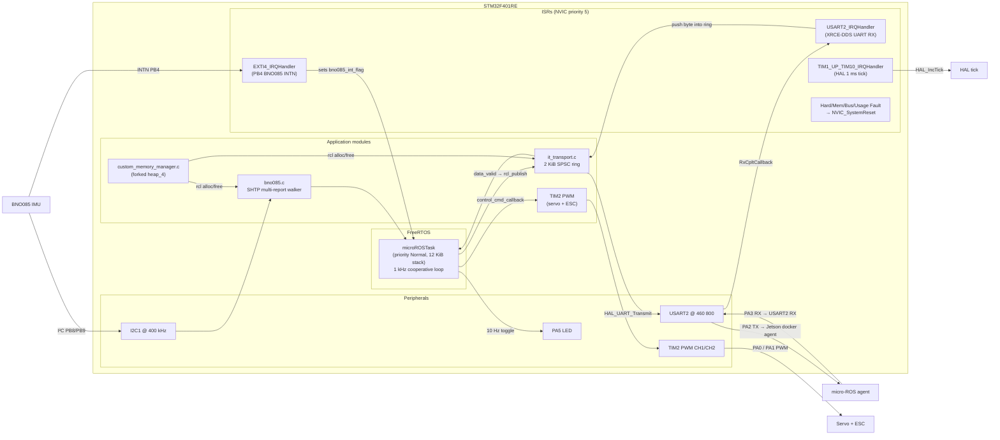

# System Overview

**Generated:** 2026-06-08 | **Phase:** 1 (Architecture Reconstruction)

## What this firmware is

The OdyssiX BFMC 2026 STM32 firmware is a **single-task FreeRTOS application** running on an STM32F401RE Nucleo board. It bridges:

- **Up** (toward the Jetson Orin Nano autonomy stack): publishes IMU data and consumes control commands via micro-ROS / XRCE-DDS over a 460 800-baud UART.
- **Down** (toward the vehicle): reads the BNO085 IMU over I²C at 100 Hz, drives the steering servo + Quicrun ESC via TIM2 PWM at 50 Hz.

It is a **co-processor for actuation and primary sensing.** The Jetson does perception, fusion, planning. The STM32 does the hard real-time bridging and the hardware fail-safe (deadman → PWM neutral).

## Hardware envelope

| Element | Configuration |
|---|---|
| MCU | STM32F401RE Nucleo, Cortex-M4F |
| Clock | **HSI 16 MHz** → PLL → **84 MHz SystemClock** (the HSI clock source, the 84 MHz system clock); voltage scale 2; FLASH wait states 2 |
| FPU | Hardware FPU, `-mfloat-abi=hard`. **`configENABLE_FPU=0`**  — single-task safe. |
| RAM | 96 KiB (2 × 32 KiB heap + ~32 KiB stacks/statics; the dual-heap sizing) |
| FLASH | 512 KiB |
| BNO085 IMU | I²C1 @ 400 kHz (PB8 SCL, PB9 SDA), INTN on **PB4 → EXTI4** (falling-edge, internal pull-up, priority 5,0) |
| Steering servo | PWM via **TIM2_CH1 on PA0** |
| Quicrun ESC | PWM via **TIM2_CH2 on PA1** |
| PWM frequency | 50 Hz (20 ms period, 1 µs counter resolution: prescaler 84−1, period 20000−1) |
| PWM neutral | **1500 µs** (servo center, ESC neutral) |
| LED | **PA5** (output PP, toggled at 10 Hz in main loop) |
| Jetson link | **USART2 @ 460 800 baud** (PA2 TX, PA3 RX), interrupt-mode RX, blocking TX, no flow control |
| Dead USART1 | 9 600 baud on PA9/PA10  |
| Watchdog | **IWDG disabled at boot**  — refresh path is no-op |
| Fault philosophy | All Cortex-M faults except NMI → `NVIC_SystemReset`  |

## Software architecture at one glance



## Single-task model — why it works

The entire user firmware runs in **one FreeRTOS task** (`microROSTask`, see `freertos.c:45-50`, `82-91`, `98-438`). All concurrency is at the ISR layer:

- ISRs are **brief**: EXTI4 just sets a `volatile bool`. USART2 RX pushes a single byte into a lock-free ring. TIM1 increments HAL tick.
- The task **polls** the EXTI flag (with a pin-LOW fallback for the back-to-back race), polls `data_valid` from the SHTP parser, and pushes IMU messages out via micro-ROS.

Trade-off: no producer/consumer task split. A long I²C stall (100 ms HAL timeout) blocks publish + actuation update. Mitigated by:

- The deadman timeout being **500 ms** (`freertos.c:411-434`) — longer than the I²C stall.
- The PWM CCRs latching at their last value during the stall (PWM hardware is independent of CPU).

For one sensor + one publish topic + one subscribe topic, this is the simplest correct design.

## Communication contract with Jetson

Two micro-ROS topics:

| Topic | Direction | Type | QoS | Rate |
|---|---|---|---|---|
| `/microros/imu_raw` | STM32 → Jetson | `sensor_msgs/Imu` | RELIABLE (rclc default), KeepLast(1) | ~100 Hz (BNO085-paced) |
| `/control/command` | Jetson → STM32 | `bfmc_msgs/ControlCommand` | RELIABLE | Jetson controller rate (~20 Hz) |

ROS domain ID **42** (hardcoded in `freertos.c:173`).

## Boot sequence — high level

See `boot_sequence.md` for the full annotated trace.

1. Reset → `Reset_Handler` (startup.s) → `SystemInit` (vendor) → data init → bss zero → `__libc_init_array` → `main`.
2. `main`: HAL init → 84 MHz PLL → GPIO/DMA/I2C/TIM/USART init → IWDG SKIPPED → FreeRTOS kernel start.
3. `microROSTask`: BNO085 init → 3 report enables → custom transport + custom allocator → ping agent → session sync → entity init → PWM start → boot calibration → infinite loop.
4. Infinite loop: executor spin → INT gate → BNO085 read → publish → LED → deadman + PWM drive → `osDelay(1)`.

## Defense-in-depth — STM32 contribution to vehicle safety

The STM32 is one of five safety layers (the others live on the Jetson). Its role:

```
┌───────────────────────────────────────────────────────────────┐
│ STM32 firmware deadman (500 ms cmd silence → PWM 1500 µs)      │ ← physical floor
│ freertos.c:411-434                                             │
└───────────────────▲───────────────────────────────────────────┘
                    │ /control/command (RELIABLE, micro-ROS)
                    │
┌───────────────────┴───────────────────────────────────────────┐
│ Jetson safety_supervisor + 5 Hz aggregator + 10 Hz watchdog    │
│ + system_state_machine ladder + behavior_planner FSM            │
└───────────────────────────────────────────────────────────────┘
```

The STM32's deadman is the **last line of defense.** Any silence longer than 500 ms forces PWM to 1500 µs neutral. This holds regardless of what happened upstream (Jetson crash, USB unplug, ROS launch killed by SIGINT).

Boot-time guarantee: **before any `/control/command` is received**, TIM2 CH1/CH2 are explicitly forced to 1500 µs (`freertos.c:213-214`). The vehicle parks until commanded.

Fault-level guarantee: **on Cortex-M fault** (memory, bus, usage), the chip reboots (`stm32f4xx_it.c`). Boot then re-pins TIM2 to neutral.

The only safety gap not yet closed: **IWDG disabled** . A pure hang without a fault doesn't reboot.

## Why a Cortex-M4F (and not a Cortex-M0+)

The dominant per-frame cost on the STM32 is BNO085 SHTP parsing + Q-point conversion to float + Hamilton quaternion product. The hardware FPU (`-mfpu=fpv4-sp-d16 -mfloat-abi=hard`) executes these in single-cycle FMA. On a Cortex-M0+ (no FPU), every float op would be software-emulated. The 100 Hz publish rate would not be sustainable.

## Coding conventions worth noting

- **CubeMX `USER CODE BEGIN/END` blocks** are preserved religiously. Code outside these blocks is regeneratable; code inside is not. The team's user code lives almost entirely inside these blocks — protective against accidental `.ioc` regeneration.
- **`volatile`** is used on shared variables touched by ISR + task (`bno085_int_flag`, `it_head`, `it_tail`, `it_data`, `last_cmd_time_ns`).
- **`__HAL_LOCK` / `__HAL_UNLOCK`** macros (in HAL UART internals) provide brief critical sections for HAL state. The team doesn't override these.
- **No DMA in active use** for USART2 RX ; the team uses IT-mode single-byte RX for XRCE-DDS robustness.

## What this firmware does NOT do

- Persistent storage (no EEPROM emulation, no NVRAM flag).
- Multi-task concurrency (one task only).
- DMA-driven RX (the configuration exists but is unused).
- Brown-out detection beyond the F4 PVD (not configured).
- USB CDC (CubeMX has the option but it's not enabled).
- I²C error recovery beyond the 50-error re-init (no SDA clock-pulse-unstick).
- Telemetry of heap high-water-mark (the function exists, nothing calls it).

These are the natural next-step items for the next development cycle.
