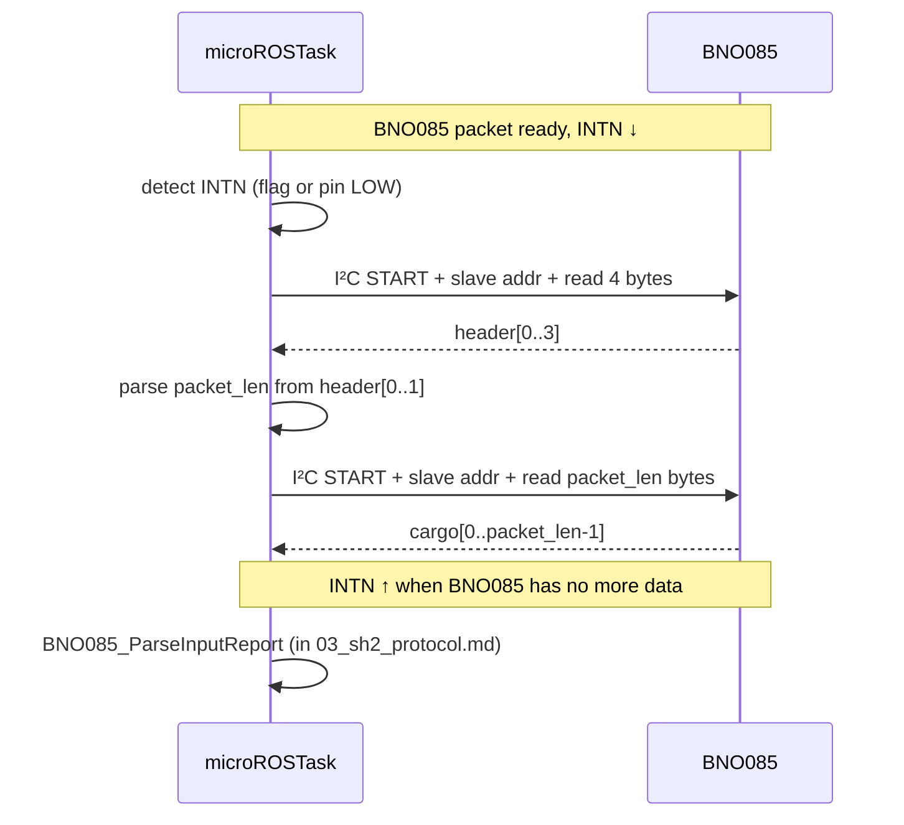

# BNO085 — 02: SHTP Protocol

## What SHTP is

**SHTP** (Sensor Hub Transport Protocol) is the BNO085's transport layer over I²C. It defines:

- A 4-byte packet header.
- Multiple logical "channels" multiplexed on the bus.
- Length-prefixed payloads.
- Per-channel sequence numbers.

The team's implementation supports the subset needed for IMU input reports — read packets from Channel 3 (Input Sensor Reports), and write Set-Feature commands on Channel 2 (Control).

## Header format

```
byte 0: length LSB
byte 1: length MSB (top bit reserved, mask with 0x7F)
byte 2: channel
byte 3: sequence number (per-channel)
```

(Source: `bno085.c:19-21` for the length parse.)

Length is the **total packet length INCLUDING the 4-byte header**. So a 30-byte cargo packet has length field = 34.

Special length values:
- `0x0000`: idle / no data
- `0x7FFF`: error / invalid

```c
uint16_t packet_len = (uint16_t)(header[0]) |
                      ((uint16_t)(header[1] & 0x7F) << 8);
if (packet_len == 0 || packet_len == 0x7FFF) return HAL_ERROR;
```
(`bno085.c:19-23`)

## SHTP channels in use

| Channel | Constant | Purpose | Use in this firmware |
|---|---|---|---|
| 0 | `BNO085_CHANNEL_COMMAND` | SHTP command (advertisements, etc.) | passively absorbed during startup flush |
| 1 | `BNO085_CHANNEL_EXE` | Executable (boot/reset announcements) | passively absorbed |
| 2 | `BNO085_CHANNEL_CONTROL` | Configuration (set feature, save DCD, etc.) | **written** for Set Feature, calibration save |
| 3 | `BNO085_CHANNEL_INPUT_SENSOR` | Sensor data reports | **read** every tick |

(Constants in `bno085.h:12-15`.)

## Per-channel sequence numbers

The BNO085 includes a per-channel sequence counter that the team's driver writes for outgoing packets:

```c
uint8_t sequence_number[6];  // bno085.h:78
```

```c
packet[3] = dev->sequence_number[channel]++;
```
(`bno085.c:47`)

Auto-incrementing. Wraps at 256.

## Two-stage read

Reads are two-phase because the cargo length is in the header:

```c
HAL_StatusTypeDef BNO085_ReadPacket(BNO085_Handle_t *dev)
{
  uint8_t header[BNO085_SHTP_HEADER_SIZE];

  // Phase 1: read header
  HAL_StatusTypeDef status = HAL_I2C_Master_Receive(
      dev->hi2c, BNO085_I2C_ADDR, header, BNO085_SHTP_HEADER_SIZE, 100);
  if (status != HAL_OK) return status;

  // Parse cargo length
  uint16_t packet_len = ...;
  if (packet_len == 0 || packet_len == 0x7FFF) return HAL_ERROR;

  // Phase 2: read cargo (clamp to rx_buf size)
  if (packet_len > sizeof(dev->rx_buf)) packet_len = sizeof(dev->rx_buf);
  status = HAL_I2C_Master_Receive(
      dev->hi2c, BNO085_I2C_ADDR, dev->rx_buf, packet_len, 100);
  return status;
}
```
(`bno085.c:9-31`)

Important quirks:

- **Two separate I²C transactions.** Each has a START + slave-address + bytes + STOP. The BNO085 must release its data correctly for the second transaction — it does because the second transaction targets the same buffer position from the BNO085's perspective.
- **Length cap.** `rx_buf` is `BNO085_MAX_PACKET_SIZE + BNO085_SHTP_HEADER_SIZE = 132 bytes` (`bno085.h:37-38, 77`). Any cargo longer than this is truncated — a defensive cap against a corrupted length field.
- **Timeout 100 ms per phase.** Worst-case I²C stall is 200 ms (two timeouts). This bounds the main loop's response time. See `data_flow_graph.md` for the impact.

## Why not single-transaction read

A single I²C transaction with `BNO085_MAX_PACKET_SIZE + 4` bytes would always read the full buffer regardless of actual packet length. The BNO085 supports this — surplus bytes after the actual packet are zero-padded. But:

- Wastes bus time on every read (~3 ms at 400 kHz for the difference).
- The team chose two-stage for accurate timing measurement and clearer error reporting.

## SHTP packet writing

```c
static HAL_StatusTypeDef BNO085_SendPacket(BNO085_Handle_t *dev,
                                           uint8_t channel,
                                           uint8_t *data,
                                           uint16_t data_len)
{
  uint16_t total_len = data_len + BNO085_SHTP_HEADER_SIZE;
  uint8_t  packet[BNO085_MAX_PACKET_SIZE];

  if (total_len > sizeof(packet)) return HAL_ERROR;

  packet[0] = (uint8_t)(total_len & 0xFF);
  packet[1] = (uint8_t)((total_len >> 8) & 0x7F);
  packet[2] = channel;
  packet[3] = dev->sequence_number[channel]++;

  memcpy(&packet[BNO085_SHTP_HEADER_SIZE], data, data_len);

  return HAL_I2C_Master_Transmit(dev->hi2c, BNO085_I2C_ADDR,
                                 packet, total_len, 100);
}
```
(`bno085.c:33-53`)

Single transaction. Length includes header. 100 ms timeout.

## Startup flush

After `BNO085_Init`, the team reads 5 packets unconditionally to drain BNO085 boot announcements (SHTP advertisement, reset announce):

```c
for (int i = 0; i < 5; i++) {
    if (BNO085_ReadPacket(dev) != HAL_OK) osDelay(50);
    else                                    osDelay(10);
}
```
(`bno085.c:278-283`)

Discarded — parser is not called. The exact count of startup packets varies; 5 is empirically sufficient.

## Failure modes

| Failure | Detection | Recovery |
|---|---|---|
| Header NACK | HAL returns error | err_count++ in main loop |
| Cargo NACK | HAL returns error | err_count++ |
| Length 0 (idle) | First-phase check | err_count++ (counts as a failed read) |
| Length 0x7FFF (error) | First-phase check | err_count++ |
| Length > 128 (corrupt) | clamped to rx_buf; data interpretation may be garbage | parser bounds-checks per-report; safe |
| Bus stuck low | both HAL receives timeout | err_count++ → eventually auto-recovery; cannot unstick bus via SDA pulses |

## Diagram


