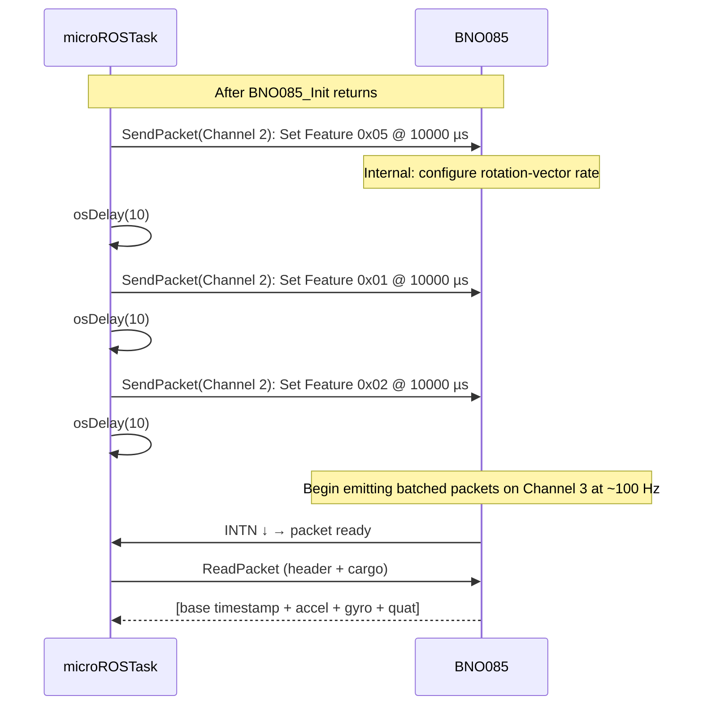

# BNO085 — 04: Report Configuration

## What "enabling a report" means

The BNO085 doesn't push data unless explicitly told to. The host sends a **Set Feature Command** on SHTP Channel 2, specifying:

- Which report ID to activate.
- At what interval (in microseconds).
- Other modifiers (sensor-specific config, batch interval).

After receiving the command, the BNO085 starts emitting that report at the requested rate (or the closest achievable rate, per its internal scheduler).

## The team's enabled reports

```c
/* freertos.c:108-122 */
BNO085_EnableReport(&bno085, BNO085_REPORT_ROTATION_VECTOR, 10000);  // 100 Hz
osDelay(10);
BNO085_EnableReport(&bno085, BNO085_REPORT_ACCELEROMETER,   10000);  // 100 Hz
osDelay(10);
BNO085_EnableReport(&bno085, BNO085_REPORT_GYROSCOPE,       10000);  // 100 Hz
osDelay(10);
```

Three reports, each at 10 000 µs = 100 Hz. The `osDelay(10)` between calls gives the BNO085 time to process each Set Feature.

## Why these specific reports

| Report | Purpose | Source comment |
|---|---|---|
| 0x05 Rotation Vector | 9-DoF magnetometer-fused orientation; provides absolute heading reference and per-frame accuracy estimate | `freertos.c:108-117`: "Provides an absolute heading reference and per-frame accuracy estimate (Q12 radians). The Jetson autonomy stack expects this on /microros/imu_raw; do NOT swap back to GRV without coordinating with the EKF/vision yaw weights on the Jetson side." |
| 0x01 Accelerometer (calibrated) | Linear acceleration with gravity present | needed for EKF pitch/roll estimation via gravity vector |
| 0x02 Gyroscope (calibrated) | Angular velocity | yaw integration, gyro-bias modelling |

**Not enabled** (but supported by the parser):

- 0x04 Linear Acceleration (gravity-removed). The team uses calibrated accel (0x01) instead because the Jetson EKF needs the gravity vector for pitch/roll observability.
- 0x08 Game Rotation Vector (6-DoF, no mag). The team used this earlier; switched to 0x05 to gain magnetometer-fused yaw. The trade-off: bumped yaw covariance from 1e-3 to 1e-2 rad² (`freertos.c:236-238`) to account for mag drift under BLDC EMI.

## Set Feature Command structure

```c
HAL_StatusTypeDef BNO085_EnableReport(BNO085_Handle_t *dev,
                                      uint8_t report_id,
                                      uint32_t interval_us)
{
    uint8_t cmd[17];
    memset(cmd, 0, sizeof(cmd));

    cmd[0] = BNO085_REPORT_SET_FEATURE_COMMAND;  // 0xFD
    cmd[1] = report_id;
    // cmd[2..4] reserved (feature flags, change sensitivity)
    cmd[5] = (uint8_t)(interval_us & 0xFF);
    cmd[6] = (uint8_t)((interval_us >> 8) & 0xFF);
    cmd[7] = (uint8_t)((interval_us >> 16) & 0xFF);
    cmd[8] = (uint8_t)((interval_us >> 24) & 0xFF);
    // cmd[9..16] reserved (batch interval, sensor-specific config)

    return BNO085_SendPacket(dev, BNO085_CHANNEL_CONTROL, cmd, sizeof(cmd));
}
```
(`bno085.c:289-305`)

17-byte command:
- Byte 0: report ID for the command itself (0xFD = Set Feature)
- Byte 1: target sensor report ID (e.g., 0x05)
- Bytes 2-4: reserved (zeroed)
- Bytes 5-8: report interval µs (uint32_t little-endian)
- Bytes 9-16: reserved (batch interval, sensor config — all zero)

Channel = 2 (Control). The BNO085 acknowledges by emitting a Get Feature Response on Channel 2 — which the team's parser doesn't read (it's not on Channel 3).

## Interval semantics

The BNO085 schedules its sensors based on the requested interval. It chooses the closest achievable rate (typically a multiple of its internal sample period, ~12.5 ms for the IMU stack).

10 000 µs requests 100 Hz. The actual emission rate is usually ~100 Hz ± a few percent.

If the interval is set too low (e.g., 1 000 µs requesting 1 kHz), the BNO085 clips to its maximum achievable rate (~400-500 Hz for the rotation vector).

If set to 0, the report is disabled.

## What's missing from the team's Set Feature

The Set Feature command has more fields than the team uses:

- **Batch interval (bytes 9-12):** allows the BNO085 to buffer reports and emit them at a slower outer rate. Could reduce INTN interrupt rate but adds latency. Not used.
- **Sensor-specific config (bytes 13-16):** per-sensor settings (e.g., ARVR stabilization for orientation reports). Not used.

The team's implementation is the minimum-correct subset.

## Dynamic Calibration (DCD) management

The BNO085 supports dynamic calibration during operation. The team exports headers for this but **doesn't call them at race time:**

```c
/* bno085.h:101-109 */
HAL_StatusTypeDef BNO085_ConfigCalibration(BNO085_Handle_t *dev,
                                           uint8_t accel_en,
                                           uint8_t gyro_en,
                                           uint8_t mag_en);
HAL_StatusTypeDef BNO085_SetDCDAutoSave(BNO085_Handle_t *dev,
                                        uint32_t period_us);
HAL_StatusTypeDef BNO085_SaveDCD(BNO085_Handle_t *dev);
HAL_StatusTypeDef BNO085_DisableDynamicCalibration(BNO085_Handle_t *dev);
```

The implementations are NOT in `bno085.c` (verified via grep). These are **declared but unimplemented** — likely planned for a future iteration but never written.

**Risk:** if a caller references them, linker error. Currently no caller exists.

**Recommendation:** either implement (small) or remove the declarations.

## Configuration sequence diagram



## Persistence

DCD (Dynamic Calibration Data) is held in the BNO085's flash. The team doesn't issue Save DCD commands — meaning calibration state isn't preserved across BNO085 power cycles.

**Practical impact:** the team's STM32-level boot calibration (`BNO085_PerformStartupCalibration`) zeros bias *at the firmware level* on every boot regardless of what the BNO085 internally has. So DCD persistence is not currently relied upon.

## Recommendations (NOT MADE — review-only)

1. **Implement or remove `BNO085_ConfigCalibration` etc.** Dead declarations are confusing.
2. **Consider enabling 0x04 Linear Acceleration as a debug report** for tuning sessions, gated by a build flag.
3. **Document the "do NOT swap to GRV" warning** prominently so a future maintainer can find it without digging through `freertos.c:108-117`.
