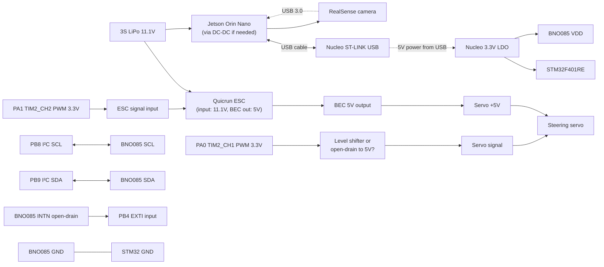

# Hardware System Connections

**Generated:** 2026-06-08 | **Phase:** 9 | **Target:** new BFMC team to reproduce wiring

## Required hardware

- STM32F401RE Nucleo board (NUCLEO-F401RE) ×1
- BNO085 IMU breakout (Adafruit BNO085 or CEVA-based equivalent) ×1
- Quicrun ESC (specific model bench-tested by team) ×1
- Standard 50 Hz analogue steering servo ×1
- Intel RealSense D435 or D455 ×1 (not connected to STM32; goes to Jetson)
- Jetson Orin Nano (or compatible ROS 2 Humble host) ×1
- USB-A to mini-USB or USB-C cable (Nucleo to Jetson) ×1
- 3S LiPo battery (11.1V nominal) ×1
- BEC (battery eliminator circuit) — typically integrated in the ESC
- Hookup wire (22-28 AWG) for I²C, INTN, PWM signals

## Master connection map



## Wiring detail tables

### STM32F401RE Nucleo header to BNO085

| Nucleo header pin | STM32 GPIO | BNO085 pin | Notes |
|---|---|---|---|
| CN10 pin 3 (3V3) | — | VIN / VDD | 3.3 V |
| CN7 pin 22 (GND) or CN10 pin 9 (GND) | — | GND | common ground |
| CN10 pin 3 (PB8) | PB8 | SCL | I²C clock |
| CN7 pin 4 (PB9) | PB9 | SDA | I²C data |
| CN5 pin 5 (PB4) | PB4 | INTN | falling-edge EXTI; internal pull-up on STM32 side; **external 4.7 kΩ pull-up to 3.3V recommended for cable runs > 10 cm** |
| (ADR tied LOW on BNO085 breakout) | — | ADR / PS0 | hardware default → I²C addr 0x4A |

**Important:** The BNO085 nRESET pin is **not connected** to the STM32 — the chip cannot be hardware-reset. If you want recoverability from a wedged BNO085, wire nRESET to a spare GPIO. NOT done in current design.

### STM32 to Steering Servo

| Nucleo header pin | STM32 GPIO | Servo wire | Notes |
|---|---|---|---|
| CN7 pin 28 (PA0) | PA0 (TIM2_CH1) | Signal | **3.3V PWM**; many servos accept 3.3V signal natively; if not, use a level shifter or open-collector buffer |
| (5V from ESC BEC) | — | +V | Servo expects 4.8-6V power |
| (common ground) | — | GND | common with STM32 + ESC |

**The team's exact level-shifting solution is NOT documented in the source code** — it's a hardware-side choice. Standard solutions:
- If servo accepts 3.3V signal directly: no shifter needed.
- Otherwise: 74LVC1T45 (single-channel) or similar level shifter, or a 2N7000 + pull-up in open-collector mode.

### STM32 to Quicrun ESC

| Nucleo header pin | STM32 GPIO | ESC wire | Notes |
|---|---|---|---|
| CN7 pin 30 (PA1) | PA1 (TIM2_CH2) | Signal (typically white/yellow wire in servo-style 3-wire connector) | 3.3V PWM; most ESCs accept |
| Battery + | — | + (typically red) | direct from LiPo +ve |
| Battery − | — | − (typically black) | common ground |

The ESC has a 3-wire signal connector (BEC out + ground + signal). The BEC output (5V) can power the servo. Common ground with STM32.

### STM32 to Jetson

| | |
|---|---|
| Connection | USB-A on Jetson ↔ mini-USB or USB-C on Nucleo ST-LINK port |
| Protocol | USB-CDC virtual serial (the Nucleo's onboard ST-LINK chip bridges USB to USART2 internally) |
| Baud rate | 460 800 |
| Jetson sees | `/dev/ttyACM0` (typically) or `/dev/ttyACM1` etc. |
| Reset trigger | DTR/RTS on the CDC line — NOT used; STM32 reset only by NRST or power cycle |

The Jetson's docker container needs `--device=/dev/ttyACM*` to access the serial port.

### Power tree

```mermaid
flowchart TB
    BAT["3S LiPo 11.1V<br/>(2200 mAh typical)"]
    BAT --> ESC["Quicrun ESC<br/>input 7-12V"]
    BAT -.->|"DC-DC or direct"| JET["Jetson Orin Nano<br/>(5V@4A typical)"]
    ESC -- "Power motor" --> MOT[BLDC motor]
    ESC -- "BEC 5V@~2A" --> SERVO[Steering servo]
    ESC -- "BEC 5V" -.-> NUCLEO_VIN["Nucleo VIN (alternative power)<br/>(not typically used — USB powers it during dev)"]
    JET -.->|"5V via USB"| NUCLEO_USB[Nucleo ST-LINK USB]
```

**Current draw estimate:**
- STM32 + BNO085: ~50 mA from 3.3V
- Servo: 0.5-1 A from 5V (depends on load)
- Motor: peaks of tens of A from 11.1V
- Jetson: 4-8 W = 1-2 A from 5V

## Pin reservation summary

| STM32 pin | Function | In use |
|---|---|---|
| PA0 | TIM2_CH1 PWM (steering) | YES |
| PA1 | TIM2_CH2 PWM (ESC) | YES |
| PA2 | USART2 TX (to Jetson) | YES |
| PA3 | USART2 RX (from Jetson) | YES |
| PA5 | LED (active high) | YES (10 Hz heartbeat) |
| PA9 | USART1 TX | dead  |
| PA10 | USART1 RX | dead  |
| PB4 | EXTI4 (BNO085 INTN) | YES |
| PB8 | I2C1 SCL | YES |
| PB9 | I2C1 SDA | YES |

**Available for future expansion:** all of GPIOC, most of GPIOA/B not listed above.

## Verification on bench

After wiring:

1. Power on STM32 (USB from Jetson is sufficient for STM32-only test).
2. Probe PA5 with a scope or LED — should see ~10 Hz toggle within ~1 s of boot.
3. Probe PA0 with a scope — should see 1500 µs PWM (50 Hz) immediately after TIM2 starts (~50 ms of boot per `freertos.c:209-214`).
4. Probe PA1 similarly — 1500 µs PWM.
5. Bring up Jetson docker + agent.
6. Observe `/microros/imu_raw` rate (`ros2 topic hz /microros/imu_raw`) — should be ~100 Hz within ~7 s.

If PB4 isn't pulled up: EXTI fires randomly; debug by probing PB4 — it should rest at 3.3V.

## What's NOT in this firmware (open future-expansion items)

- Encoder input (no wheel speed feedback).
- nRESET to BNO085 (no hardware reset of IMU).
- Telemetry UART (USART1 is dead).
- USB CDC for diagnostic console (USART2 USB-CDC is consumed by micro-ROS).
- Additional sensors (the BNO085 is the only one).

## Reference

- STM32F401RE datasheet for pinout details.
- Nucleo-F401RE user manual (UM1724) for header pin numbering.
- BNO085 datasheet for I²C address selection.
- Quicrun ESC manual for the specific model (the team's exact model is NOT in this repo).
